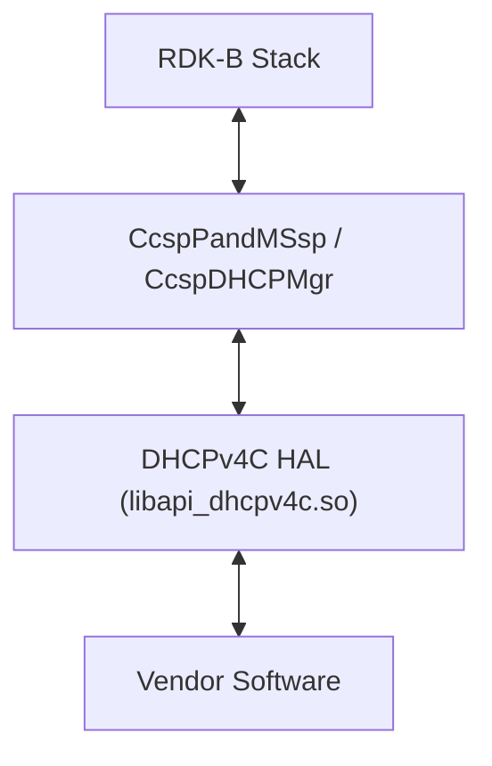
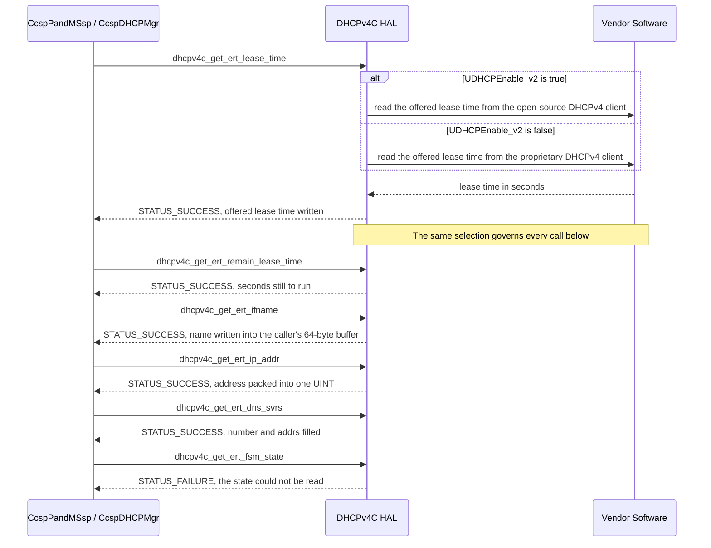

# DHCPv4C HAL Documentation

## Version History

| Date | Comment | Version |
| --- | --- | --- |
| 2024-07-13 | Initial publication, alongside the migration of the DHCPv4 client headers to GitHub. | 1.0.0 |
| Not recorded | Corrected variable names in `dhcpv4c_api.h`. The repository's changelog carries this release as a bare compare link with no date, so no date is asserted here. | 1.0.1 |
| 2026-08-24 | Specification rebuilt against the two headers: the API narrative replaced with the 54 declared accessors, the topic set brought to the canonical form, and a previously documented client lifecycle and DHCPv4 server surface removed because neither is declared. | Unreleased |

## Acronyms

- `API` \- Application Programming Interface
- `DHCP` \- Dynamic Host Configuration Protocol
- `DHCPC` \- DHCP Client, as used in the enumeration names in `dhcp4cApi.h`
- `DHCPv4` \- DHCP for IPv4, the protocol version this interface reports on
- `DHCPv4C` \- DHCPv4 Client, the subject of this interface
- `DNS` \- Domain Name System
- `ECM` \- Embedded Cable Modem
- `eMTA` \- Embedded Multimedia Terminal Adapter
- `E-Router` \- Embedded Router, the routed IPv4 interface of an RDK-B gateway
- `FSM` \- Finite State Machine, the state model a DHCPv4 client runs
- `HAL` \- Hardware Abstraction Layer
- `IPv4` \- Internet Protocol version 4
- `RDK-B` \- Reference Design Kit for Broadband Devices
- `SLA` \- Service Level Agreement

## Description

The diagram below describes a high-level software architecture of the DHCPv4C HAL module stack.

DHCPv4C HAL is an abstraction layer through which RDK-B middleware reads the state of the DHCPv4
clients running on a broadband gateway. `CcspPandMSsp` and `CcspDHCPMgr` are the RDK-B services
that own and call this HAL; other components of the RDK-B stack reach DHCPv4 state through them.

For each of three modules \- the E-Router, the ECM and the eMTA \- the interface reports values a
DHCPv4 client has already learned: the offered lease time; the lease, renewal and rebind time still
to run; the number of configuration attempts; the name of the interface the client is bound to; the
client's FSM state; and its IPv4 configuration, namely address, subnet mask, default gateway, DNS
server list and the address of the DHCPv4 server that answered it.

The interface is read-only and client-only. It declares no initialization, teardown, start, stop or
renew call, no setter, no callback registration, no context handle and no DHCPv4 server surface.

Two headers declare the same surface in different types, and a caller uses the one whose types
match its own build:

- `include/dhcp4cApi.h` declares the `dhcp4c_*` family in plain C types \- `int`, `unsigned int`
  and `char` \- and reports address lists in `ipv4AddrList_t`.
- `include/dhcpv4c_api.h` declares the `dhcpv4c_*` family in the RDK compatibility macros `INT`,
  `UINT` and `CHAR`, and reports address lists in `dhcpv4c_ip_list_t`.

## Optional Components

The eMTA module is optional at compile time. Both families declare their eMTA accessors, and
`dhcp4cApi.h` declares the `DHCPC_EMTA` enumerator, only when `NO_MTA_FEATURE_SUPPORT` is not
defined:

- `dhcp4c_get_emta_remain_lease_time`, `dhcp4c_get_emta_remain_renew_time` and
  `dhcp4c_get_emta_remain_rebind_time`;
- `dhcpv4c_get_emta_remain_lease_time`, `dhcpv4c_get_emta_remain_renew_time` and
  `dhcpv4c_get_emta_remain_rebind_time`;
- `DHCPC_EMTA`, the eMTA member of the `DHCPC_MODULE` enumeration.

The flag adds or removes `DHCPC_EMTA` only and leaves the values of the other `DHCPC_MODULE`
members unchanged. When present, the eMTA module exposes only the three remaining-time accessors.
Every other accessor, type and constant is declared unconditionally.

## Component Runtime Execution Requirements

### Initialization and Startup

This interface has no initialization or teardown call and no context or handle type. A caller reads
a value without opening or closing a session, and any accessor may be the first one it invokes.

Vendor implementations must meet the following requirements:

- **Implementation selection.** The HAL implementation selects between open-source and proprietary
  DHCPv4c APIs on the value of the `UDHCPEnable_v2` configuration parameter: the open-source APIs
  when it is true, the proprietary ones when it is false. The selection changes which software
  answers a call, not the signature or return convention of that call.
- **Hardware readiness.** Vendors must ensure the HAL waits for the underlying network hardware to
  be ready before initiating any DHCP operation, for example by checking for a valid network
  interface and link status.
- **Error handling.** Vendors must handle the cases where `UDHCPEnable_v2` is not set, is invalid,
  or is inaccessible.

A representative first read of E-Router state uses the accessors below, in no required order:

- `dhcpv4c_get_ert_ifname`
- `dhcpv4c_get_ert_fsm_state`
- `dhcpv4c_get_ert_ip_addr`
- `dhcpv4c_get_ert_mask`
- `dhcpv4c_get_ert_gw`
- `dhcpv4c_get_ert_lease_time`
- `dhcpv4c_get_ert_remain_lease_time`
- `dhcpv4c_get_ert_dns_svrs`

The `dhcp4c_*` family exposes the same values under the `dhcp4c_` prefix.

### Threading Model

This interface is not required to be thread safe.

Any module which is invoking the API must ensure calls are made in a thread safe manner,
serialising any invocations it shares between threads.

Vendors may implement internal threading and event mechanisms to meet their operational
requirements. These mechanisms must be designed to ensure thread safety when interacting with the
HAL interface. Proper cleanup of allocated resources \- memory, file handles and threads \- is
mandatory when the vendor software terminates or closes its connection to the HAL.

### Process Model

All APIs are expected to be called from multiple processes. Vendors must implement protection
mechanisms within their API implementations to handle multiple processes calling the same API
simultaneously, so that data integrity is preserved and race conditions are prevented.

### Memory Model

Every accessor writes its result through one caller-supplied output location. No accessor allocates
memory on the caller's behalf or returns anything the caller must release.

#### Caller Responsibilities

- Allocate the output location for every call, and keep it allocated and unmoved after the call
  returns; confirm with the vendor implementation before reusing or releasing it.
- Pass a buffer of at least 64 bytes to `dhcp4c_get_ert_ifname`, `dhcp4c_get_ecm_ifname`,
  `dhcpv4c_get_ert_ifname` and `dhcpv4c_get_ecm_ifname`. These accessors receive no buffer length,
  so a shorter buffer risks an overrun.
- After a successful address-list read, read only entries `0` through `number - 1`.
- After a failed call, discard the content of the output location and do not read a character
  buffer as a string.

#### Module Responsibilities

- Modules must allocate and de-allocate memory for their internal operations, and release all
  internally allocated memory upon closure to prevent resource leaks.
- All strings used in this module must be zero-terminated.
- An accessor writing into a character buffer must write no more than that buffer holds.

### Power Management Requirements

The HAL is not involved in any power management operation.

### Asynchronous Notification Model

There are no asynchronous notifications. A caller that needs to know when a lease changes polls the
accessors it needs.

### Blocking calls

- Every accessor is synchronous: it returns its status at the point of call, with the value written
  to the caller's output location. No result is delivered later.
- No accessor takes a timeout argument, and an issued call cannot be cancelled. A caller that needs
  a deadline enforces it outside this interface.

### Internal Error Handling

- **Synchronous Error Handling:** All APIs must return errors synchronously as a return value.
- **Internal Error Reporting:** The HAL is responsible for reporting any internal system errors,
  such as an out-of-memory condition, through the return value.
- **Focus on Logging for Errors:** For system errors, the HAL should prioritize logging the error
  details for further investigation and resolution.

Every accessor in both families returns one of two values:

| Return value | Meaning | Caller action |
| --- | --- | --- |
| `STATUS_SUCCESS` (`0`) | The value was retrieved and written to the caller's output location. | Read the output location. |
| `STATUS_FAILURE` (`-1`) | The value was not retrieved: a rejected argument, a value the DHCPv4 client has not yet learned, and an internal error all return this code. | Re-check the pointer and, for the interface-name accessors, the buffer size; read the matching FSM state accessor; otherwise treat the value as unavailable and read it again later. Never substitute a default such as zero. |

`STATUS_SUCCESS` and `STATUS_FAILURE` are defined in `dhcpv4c_api.h` only, as `#ifndef`-guarded
fallbacks. `dhcp4cApi.h` uses both names in its documentation but includes no other header, so a
caller of the `dhcp4c_*` family also includes `dhcpv4c_api.h` or compares the return value against
`0` and `-1` directly.

### Persistence Model

There is no requirement for HAL to persist any setting information.

## Non functional requirements

The following non functional requirements should be supported by the component.

### Logging and debugging requirements

The component should log all errors and critical informative messages, to help debug and triage
issues and to make the functional flow of the system understandable. Logging should use `syslog`;
`printf` is discouraged unless `syslog` is not available.

Logging should be consistent across all HAL components. When logging is necessary, it should be
performed into the `dhcp_vendor_hal.log` file, located in either the `/var/tmp/` or the
`/rdklogs/logs/` directory.

Logs must be categorized by the Linux standard log levels, in descending order of severity:
`FATAL`, `ERROR`, `WARNING`, `NOTICE`, `INFO`, `DEBUG` and `TRACE`. Each log entry should include a
timestamp, the log level and a message describing the event or condition.

Because `STATUS_FAILURE` carries no detail, an implementation should log the reason for every
failure it returns.

Implementations must not log credentials, secrets, security-sensitive information, or other sensitive data.

### Memory and performance requirements

The component should be designed for efficiency, minimizing its impact on system resources during
normal operation. Resource utilization, of CPU and memory alike, should be proportional to the
specific task being performed and align with any performance expectations documented in the API
specifications.

### Quality Control

To ensure the highest quality and reliability, it is strongly recommended that third-party quality
assurance tools like `Coverity`, `Black Duck` and `Valgrind` be employed to thoroughly analyze the
implementation. The goal is to detect and resolve potential issues such as memory leaks, memory
corruption, or other defects before deployment.

Furthermore, both the HAL wrapper and any third-party software interacting with it must prioritize
robust memory management practices. This includes meticulous allocation, deallocation, and error
handling to guarantee a stable and leak-free operation.

Any change to a file listed under `Source References` obliges a review of this document. That review
follows the route `CONTRIBUTING.md` prescribes: raise an issue against the repository, open a pull
request, and the team reviews and merges it.

### Licensing

The implementation is expected to be released under the Apache License 2.0.

### Build Requirements

The source code should be capable of, but not be limited to, building under the Yocto distribution
environment. The recipe should deliver a shared library named `libapi_dhcpv4c.so`.

A consumer of this interface:

1. includes `dhcp4cApi.h`, `dhcpv4c_api.h`, or both, according to the types it builds in;
2. adds a linker dependency for `libapi_dhcpv4c.so`.

This repository ships the interface headers; `libapi_dhcpv4c.so` is delivered by the vendor
implementation.

### Variability Management

Changes to the interface will be controlled by versioning, vendors will be expected to implement to
a fixed version of the interface, and based on SLA agreements move to later versions as demand
requires.

Each API interface will be versioned using [Semantic Versioning 2.0.0](https://semver.org/spec/v2.0.0.html), and
the vendor code will comply with a specific version of the interface. The interface version a caller
compiles against is identified by the repository's release tag.

Two flags vary this interface, and they vary different things:

| Flag | Kind | Effect |
| --- | --- | --- |
| `UDHCPEnable_v2` | Run-time configuration parameter | Selects which DHCPv4 client software answers a call, as `Initialization and Startup` describes. The declared surface is identical either way. |
| `NO_MTA_FEATURE_SUPPORT` | Compile-time flag | When defined, removes the eMTA elements listed under `Optional Components`. The declared surface differs. |

Because `NO_MTA_FEATURE_SUPPORT` changes the declared surface, integrators must apply the same
setting to the caller and to the implementation.

### Platform or Product Customization

A platform or product integrator customizes this interface only through the two flags under
`Variability Management`. Everything else \- the signatures of the 54 read-only accessors, the
`STATUS_SUCCESS` and `STATUS_FAILURE` return convention, the 64-byte interface-name buffer minimum,
the four-address list capacity, the three modules and the FSM state values \- is fixed by the
headers.

## Interface API Documentation

All HAL function prototypes and datatype definitions are available in the `include/dhcp4cApi.h`
and `include/dhcpv4c_api.h` files. `dhcp4cApi.h` declares the Doxygen group `DHCPV4C_HAL` with its
`DHCPV4C_HAL_TYPES` and `DHCPV4C_HAL_APIS` subgroups, which `dhcpv4c_api.h` re-opens rather than
redefining.

### Theory of operation and key concepts

This interface reports the state of DHCPv4 clients; it does not drive them. A vendor
implementation runs, or reads from, a DHCPv4 client for each of up to three modules \- the
E-Router, the ECM and the eMTA \- and each accessor reports one value about one module.

The 54 accessors are 27 matched pairs across the two families described under `Description`: every
`dhcp4c_` accessor has a `dhcpv4c_` counterpart reporting the same value about the same module. No
accessor reports two values or takes a selector, so a caller selects a value by choosing the
function name.

#### Object Lifecycles

There is no object. This interface creates and destroys nothing, and no accessor takes or returns a
handle or context. Every accessor reads the state of a DHCPv4 client the vendor implementation is
already running; the only storage a caller manages is its own output locations, as `Memory Model`
describes.

#### Method Sequencing

The accessors are independent and impose no ordering: a caller may invoke any of them, in any
order. Successive calls are independent reads of a client that keeps running between them, so
values read in separate calls can disagree \- a state read as `5` (`BOUND`) alongside a remaining lease time
that has since reached zero, for instance. Because there is no initialization call, a
`STATUS_FAILURE` never means "call something else first".

#### State-Dependent Behavior

What an accessor returns depends on the state of the DHCPv4 client it reports on, which four
accessors read: `dhcp4c_get_ert_fsm_state`, `dhcp4c_get_ecm_fsm_state`, `dhcpv4c_get_ert_fsm_state`
and `dhcpv4c_get_ecm_fsm_state`.

A value the client has not yet learned is reported as `STATUS_FAILURE`, the same code a rejected
pointer returns: an address accessor called before a lease has been granted, or a remaining-time
accessor called while no lease is held, fails. A caller reads the state accessor to tell which
situation it is in. The state values are listed under `State Diagram`.

### Data Structures and Defines

The two headers define separate type sets. Neither header includes the other, so a caller cannot
pass one family's list structure to the other family's accessor.

`dhcp4cApi.h` \- the plain-C family.

| Definition | Kind | What it represents |
| --- | --- | --- |
| `DHCPC_CMD` | Enumeration, 13 members | The value space this interface covers: one member per kind of DHCPv4 client information it reports. |
| `DHCPC_MODULE` | Enumeration, 2 or 3 members | The modules this interface reports on. `DHCPC_EMTA` is present only when `NO_MTA_FEATURE_SUPPORT` is not defined. |
| `MAX_IPV4_ADDR_LIST_NUMBER` | Macro constant, `4` | Capacity of `ipv4AddrList_t::addrList`, and the most addresses a DNS server list reports. |
| `ipv4AddrList_t` | Structure typedef | A list of IPv4 addresses, filled by the two DNS server accessors of this family. |

`DHCPC_CMD` members, in declaration order: `DHCPC_CMD_LEASE_TIME`, `DHCPC_CMD_LEASE_TIME_REMAIN`,
`DHCPC_CMD_RENEW_TIME_REMAIN`, `DHCPC_CMD_REBIND_TIME_REMAIN`, `DHCPC_CMD_CONFIG_ATTEMPTS`,
`DHCPC_CMD_GET_IFNAME`, `DHCPC_CMD_FSM_STATE`, `DHCPC_CMD_IP_ADDR`, `DHCPC_CMD_IP_MASK`,
`DHCPC_CMD_ROUTERS`, `DHCPC_CMD_DNS_SVRS`, `DHCPC_CMD_DHCP_SVR` and `DHCPC_CMD_MAX`, the last being
a bound rather than a value.

`DHCPC_MODULE` members: `DHCPC_ECM` is 0, `DHCPC_EROUTER` is 1, and `DHCPC_EMTA` is 2 when
declared.

`DHCPC_CMD` and `DHCPC_MODULE` appear in no declared signature: they describe the interface's
coverage rather than parameterising a call.

`ipv4AddrList_t` fields: `int number`, the count of entries filled, and
`unsigned int addrList[MAX_IPV4_ADDR_LIST_NUMBER]`, the addresses themselves.

`dhcpv4c_api.h` \- the RDK compatibility family.

| Definition | Kind | What it represents |
| --- | --- | --- |
| `DHCPV4_MAX_IPV4_ADDRS` | Macro constant, `4` | Capacity of `dhcpv4c_ip_list_t::addrs`, matching the other family's cap. |
| `dhcpv4c_ip_list_t` | Structure typedef | A list of IPv4 addresses, filled by the two DNS server accessors of this family. |

`dhcpv4c_ip_list_t` fields: `INT number`, the count of entries filled, and
`UINT addrs[DHCPV4_MAX_IPV4_ADDRS]`, the addresses themselves.

In both list structures, and in every single-address accessor, each IPv4 address is packed into
one 32-bit word in an implementation-defined byte order; a caller confirms the order with the vendor
implementation rather than assuming host or network order.

The same header also carries eleven `#ifndef`-guarded compatibility definitions, which decide the
signature of every declaration in that family:

| Definition | Value | Referenced by a declaration? |
| --- | --- | --- |
| `INT` | `int` | Yes \- the return type of every accessor, and the output type of the state and attempt-count accessors. |
| `UINT` | `unsigned int` | Yes \- carries lease timers in seconds and packed 32-bit addresses. |
| `CHAR` | `char` | Yes \- the two interface-name accessors take `CHAR *`, so their buffers are sized in bytes. |
| `STATUS_SUCCESS` | `0` | Yes \- the success code of both families. |
| `STATUS_FAILURE` | `-1` | Yes \- the only failure code either family defines. |
| `ULONG` | `unsigned long` | No. |
| `BOOL` | `unsigned char` | No. |
| `UCHAR` | `unsigned char` | No. |
| `TRUE` | `1` | No. |
| `FALSE` | `0` | No. |
| `ENABLE` | `1` | No. |

Each of these definitions yields to one the including environment already provides, so a platform
that defines `INT`, `UINT` or `CHAR` differently changes the signature of every declaration in this
family. A caller that combines this header with its own compatibility layer must confirm the two
agree. `Internal Error Handling` states how a caller of the `dhcp4c_*` family obtains
`STATUS_SUCCESS` and `STATUS_FAILURE`.

### API Surface

This interface declares 54 accessors: 27 in each family, and within each family 12 for the
E-Router, 12 for the ECM and 3 for the eMTA. Every accessor takes a single caller-owned output
location, writes one value through it and returns `STATUS_SUCCESS` or `STATUS_FAILURE`; none takes
an input parameter, a selector or a handle. The Doxygen block on each declaration carries its
declaration-level documentation.

**The `dhcp4c_*` family \- `dhcp4cApi.h`.** Plain C types; address lists in `ipv4AddrList_t`.

*E-Router module \- 12 accessors.*

| Accessor | Value reported |
| --- | --- |
| `dhcp4c_get_ert_lease_time` | The whole lease duration the E-Router's DHCPv4 server offered, in seconds. Fixed when the lease was taken; it does not count down. |
| `dhcp4c_get_ert_remain_lease_time` | Seconds of the current E-Router lease still to run. |
| `dhcp4c_get_ert_remain_renew_time` | Seconds until the E-Router client next attempts to renew its lease. |
| `dhcp4c_get_ert_remain_rebind_time` | Seconds until the E-Router client falls back from renewing to rebinding. |
| `dhcp4c_get_ert_config_attempts` | Number of configuration attempts the E-Router client has made. |
| `dhcp4c_get_ert_ifname` | Name of the network interface the E-Router client is bound to, written into a caller-allocated buffer of at least 64 bytes. |
| `dhcp4c_get_ert_fsm_state` | The E-Router client's FSM state, as one of the integers listed under `State Diagram`. |
| `dhcp4c_get_ert_ip_addr` | IPv4 address leased to the E-Router, packed into a single 32-bit word. |
| `dhcp4c_get_ert_mask` | Subnet mask leased to the E-Router, packed into a single 32-bit word. |
| `dhcp4c_get_ert_gw` | Default gateway offered to the E-Router, packed into a single 32-bit word. |
| `dhcp4c_get_ert_dns_svrs` | DNS servers offered with the E-Router lease, as an `ipv4AddrList_t` of up to `MAX_IPV4_ADDR_LIST_NUMBER` entries. |
| `dhcp4c_get_ert_dhcp_svr` | Address of the DHCPv4 server that answered the E-Router, packed into a single 32-bit word. |

*ECM module \- 12 accessors, reporting the same twelve values about the Embedded Cable Modem.*

| Accessor | Value reported |
| --- | --- |
| `dhcp4c_get_ecm_lease_time` | The whole lease duration the ECM's DHCPv4 server offered, in seconds. |
| `dhcp4c_get_ecm_remain_lease_time` | Seconds of the current ECM lease still to run. |
| `dhcp4c_get_ecm_remain_renew_time` | Seconds until the ECM client next attempts to renew its lease. |
| `dhcp4c_get_ecm_remain_rebind_time` | Seconds until the ECM client falls back from renewing to rebinding. |
| `dhcp4c_get_ecm_config_attempts` | Number of configuration attempts the ECM client has made. |
| `dhcp4c_get_ecm_ifname` | Name of the network interface the ECM client is bound to, written into a caller-allocated buffer of at least 64 bytes. |
| `dhcp4c_get_ecm_fsm_state` | The ECM client's FSM state, as one of the integers listed under `State Diagram`. |
| `dhcp4c_get_ecm_ip_addr` | IPv4 address leased to the ECM, packed into a single 32-bit word. |
| `dhcp4c_get_ecm_mask` | Subnet mask leased to the ECM, packed into a single 32-bit word. |
| `dhcp4c_get_ecm_gw` | Default gateway offered to the ECM, packed into a single 32-bit word. |
| `dhcp4c_get_ecm_dns_svrs` | DNS servers offered with the ECM lease, as an `ipv4AddrList_t` of up to `MAX_IPV4_ADDR_LIST_NUMBER` entries. |
| `dhcp4c_get_ecm_dhcp_svr` | Address of the DHCPv4 server that answered the ECM, packed into a single 32-bit word. |

*eMTA module \- 3 accessors, declared only when `NO_MTA_FEATURE_SUPPORT` is not defined.*

| Accessor | Value reported |
| --- | --- |
| `dhcp4c_get_emta_remain_lease_time` | Seconds of the current eMTA lease still to run. |
| `dhcp4c_get_emta_remain_renew_time` | Seconds until the eMTA client next attempts to renew its lease. |
| `dhcp4c_get_emta_remain_rebind_time` | Seconds until the eMTA client falls back from renewing to rebinding. |

**The `dhcpv4c_*` family \- `dhcpv4c_api.h`.** The same 27 values, declared in the RDK
compatibility macros `INT`, `UINT` and `CHAR`, with address lists in `dhcpv4c_ip_list_t` and its
`DHCPV4_MAX_IPV4_ADDRS` cap.

*E-Router module \- 12 accessors.*

| Accessor | Value reported |
| --- | --- |
| `dhcpv4c_get_ert_lease_time` | The offered E-Router lease duration in seconds, as a `UINT`. |
| `dhcpv4c_get_ert_remain_lease_time` | Seconds of the current E-Router lease still to run. |
| `dhcpv4c_get_ert_remain_renew_time` | Seconds until the E-Router client next attempts renewal. |
| `dhcpv4c_get_ert_remain_rebind_time` | Seconds until the E-Router client falls back to rebinding. |
| `dhcpv4c_get_ert_config_attempts` | E-Router configuration attempt count, as an `INT`. |
| `dhcpv4c_get_ert_ifname` | E-Router interface name, into a caller-allocated `CHAR` buffer of at least 64 bytes. |
| `dhcpv4c_get_ert_fsm_state` | The E-Router client's FSM state, as an `INT` taking one of the values under `State Diagram`. |
| `dhcpv4c_get_ert_ip_addr` | IPv4 address leased to the E-Router, packed into one `UINT`. |
| `dhcpv4c_get_ert_mask` | Subnet mask leased to the E-Router, packed into one `UINT`. |
| `dhcpv4c_get_ert_gw` | Default gateway offered to the E-Router, packed into one `UINT`. |
| `dhcpv4c_get_ert_dns_svrs` | DNS servers offered with the E-Router lease, into a `dhcpv4c_ip_list_t`. |
| `dhcpv4c_get_ert_dhcp_svr` | Address of the DHCPv4 server that answered the E-Router, packed into one `UINT`. |

*ECM module \- 12 accessors.*

| Accessor | Value reported |
| --- | --- |
| `dhcpv4c_get_ecm_lease_time` | The offered ECM lease duration in seconds, as a `UINT`. |
| `dhcpv4c_get_ecm_remain_lease_time` | Seconds of the current ECM lease still to run. |
| `dhcpv4c_get_ecm_remain_renew_time` | Seconds until the ECM client next attempts renewal. |
| `dhcpv4c_get_ecm_remain_rebind_time` | Seconds until the ECM client falls back to rebinding. |
| `dhcpv4c_get_ecm_config_attempts` | ECM configuration attempt count, as an `INT`. |
| `dhcpv4c_get_ecm_ifname` | ECM interface name, into a caller-allocated `CHAR` buffer of at least 64 bytes. |
| `dhcpv4c_get_ecm_fsm_state` | The ECM client's FSM state, as an `INT` taking one of the values under `State Diagram`. |
| `dhcpv4c_get_ecm_ip_addr` | IPv4 address leased to the ECM, packed into one `UINT`. |
| `dhcpv4c_get_ecm_mask` | Subnet mask leased to the ECM, packed into one `UINT`. |
| `dhcpv4c_get_ecm_gw` | Default gateway offered to the ECM, packed into one `UINT`. |
| `dhcpv4c_get_ecm_dns_svrs` | DNS servers offered with the ECM lease, into a `dhcpv4c_ip_list_t`. |
| `dhcpv4c_get_ecm_dhcp_svr` | Address of the DHCPv4 server that answered the ECM, packed into one `UINT`. |

*eMTA module \- 3 accessors, declared only when `NO_MTA_FEATURE_SUPPORT` is not defined.*

| Accessor | Value reported |
| --- | --- |
| `dhcpv4c_get_emta_remain_lease_time` | Seconds of the current eMTA lease still to run. |
| `dhcpv4c_get_emta_remain_renew_time` | Seconds until the eMTA client next attempts renewal. |
| `dhcpv4c_get_emta_remain_rebind_time` | Seconds until the eMTA client falls back to rebinding. |

### Sequence Diagram

The exchange below shows `CcspPandMSsp` or `CcspDHCPMgr` reading E-Router state, with the
`UDHCPEnable_v2` selection described under `Initialization and Startup` deciding which DHCPv4
client the vendor software reads.

The six reads may occur in any order, and the `dhcp4c_*` family follows the same exchange with
plain C output types. `Internal Error Handling` gives the caller's response to the final
`STATUS_FAILURE`.

### State Diagram

The four state accessors named under `State-Dependent Behavior` report the DHCPv4 client's FSM
state as one of six plain integers:

| Value | State reported |
| --- | --- |
| `1` | `RELEASED` or `INIT_REBOOT` |
| `2` | `INIT_SELECTING` |
| `3` | `REQUESTING` |
| `4` | `REBINDING` |
| `5` | `BOUND` |
| `6` | `RENEWING` or `RENEW_REQUESTED` |

A caller compares the returned integer against these literals; `DHCPC_CMD` and `DHCPC_MODULE` are
unrelated to them. Values `1` and `6` each cover two protocol states that a caller cannot tell apart.

The interface defines these state values but no transitions between them, so no state diagram is
drawn.

## Source References

- [rdkcentral/rdkb-halif-dhcp/include/dhcp4cApi.h](https://github.com/rdkcentral/rdkb-halif-dhcp/blob/develop/include/dhcp4cApi.h) — the `dhcp4c_*` accessor family, its types and the FSM state values
- [rdkcentral/rdkb-halif-dhcp/include/dhcpv4c_api.h](https://github.com/rdkcentral/rdkb-halif-dhcp/blob/develop/include/dhcpv4c_api.h) — the `dhcpv4c_*` accessor family, the compatibility definitions and the status codes
- [rdkcentral/rdkb-halif-dhcp/CHANGELOG.md](https://github.com/rdkcentral/rdkb-halif-dhcp/blob/develop/CHANGELOG.md) — release history
- [rdkcentral/rdkb-halif-dhcp/CONTRIBUTING.md](https://github.com/rdkcentral/rdkb-halif-dhcp/blob/develop/CONTRIBUTING.md) — contribution and review route
- [rdkcentral/rdkb-halif-dhcp/LICENSE](https://github.com/rdkcentral/rdkb-halif-dhcp/blob/develop/LICENSE) — Apache License 2.0
- [rdkcentral/rdkb-halif-dhcp/NOTICE](https://github.com/rdkcentral/rdkb-halif-dhcp/blob/develop/NOTICE) — copyright and licensing notices
